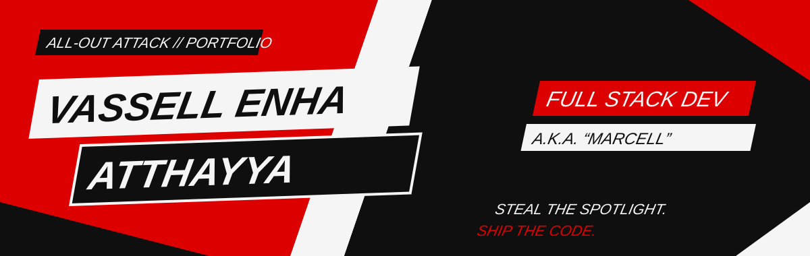

<div align="center">



<br />

[](https://web-nu-wine-25.vercel.app/)
[](https://nextjs.org/)
[](https://tailwindcss.com/)
[](https://expressjs.com/)

**Portofolio full-stack bertema Persona 5 UI. Ultra-ringan, tanpa database, tanpa library animasi.**

</div>


## ▌ MISSION BRIEFING

Portofolio ini dibangun ulang dari nol setelah versi CSR sebelumnya gagal karena JavaScript client yang terlalu berat. Aturannya satu: **tampil radikal, load secepat mungkin.**

- **Server Components dulu.** Data diambil di server, browser menerima HTML siap pakai.
- **Tailwind murni + CSS native.** Tidak ada Framer Motion, Three.js, atau React-Spring.
- **Tanpa database.** Data hidup di file JSON dan dibaca lewat `fs/promises`.
- **Client Component dibatasi** hanya untuk bagian yang memang interaktif.


## ▌ STATUS SCREEN

Atribut Phantom Thief, dihubungkan ke skill teknis.

| Atribut | Level | Skill |
| :-- | :-- | :-- |
| **Knowledge** | `▰▰▰▰▰▰▰▰▱` 8 | Sistem Informasi, analisis dan perancangan sistem, SQL, JavaScript |
| **Guts** | `▰▰▰▰▰▰▰▱▱` 7 | Deploy ke production, debugging di bawah tekanan, kompetisi bisnis |
| **Proficiency** | `▰▰▰▰▰▰▰▰▱` 8 | Next.js, React, Node.js, Express, Tailwind CSS |
| **Kindness** | `▰▰▰▰▰▰▰▱▱` 7 | Code review, dokumentasi, kolaborasi lintas tim |
| **Charm** | `▰▰▰▰▰▰▱▱▱` 6 | UI/UX, presentasi, storytelling produk |


## ▌ FITUR

| | |
| :-- | :-- |
| **Dark / Light mode** | Tema merah-hitam-putih khas Persona 5. Script inline di `<head>` mencegah flash saat load. |
| **Jukebox** | Playlist OST original (Suno) dengan shuffle, volume, progress, dan Media Session. Tidak pernah autoplay. |
| **Command Wheel** | Tekan `M` untuk menu navigasi bergaya Persona. |
| **Playground** | Calling Card Generator, mini-game *Steal the Treasure*, Stat Allocator, kartu heist dan confidant yang bisa di-flip. |
| **Easter egg** | Masukkan Konami Code dan lihat apa yang terjadi. |
| **Ringan** | Animasi CSS native, ikon SVG inline, menghormati `prefers-reduced-motion`. |


## ▌ HEISTS

| Codename | Status |
| :-- | :-- |
| **Operation: Enterprise Helpdesk 2.0 & E.V.A** | `SECURED` |
| **Operation: AMANIN** | `IN PROGRESS` |
| **Operation: Pharvia** | `IN PROGRESS` |
| **Operation: Portfolio** | `SECURED` |


## ▌ ARSITEKTUR

```
┌──────────────────────┐   fetch (server-side)   ┌────────────────────────┐
│  /web                │ ──────────────────────▶ │  /api                  │
│  Next.js App Router  │      ISR (60 detik)     │  Node.js + Express     │
│  Vercel              │ ◀────────────────────── │  Render                │
└──────────────────────┘     JSON + fallback     └───────────┬────────────┘
                                                             │ fs/promises
                                                   ┌─────────▼──────────┐
                                                   │  api/data/*.json   │
                                                   └────────────────────┘
```

| Bagian | Teknologi |
| :-- | :-- |
| **Frontend** | Next.js (App Router, React Server Components), Tailwind CSS v3 |
| **Backend** | Node.js >= 20, Express 5, REST API minimalis |
| **Data** | File JSON lokal (`profile.json`, `heists.json`, `confidants.json`) |
| **Deploy** | Web di Vercel, API di Render |

Endpoint: `GET /api/profile` · `GET /api/heists` · `GET /health`

Kalau API tidak terjangkau (misalnya Render free tier sedang tidur), web memakai data fallback lokal dengan timeout 4 detik, jadi halaman tidak pernah kosong.


## ▌ JALANKAN LOKAL

Butuh Node.js >= 20.

```bash
npm run install:all   # sekali saja
npm run dev           # API :4000 + Web :3000 sekaligus
```

<details>
<summary><b>Atau manual, dua terminal</b></summary>

```bash
# Terminal 1 — API (http://localhost:4000)
cd api
npm install
npm run dev

# Terminal 2 — Web (http://localhost:3000)
cd web
cp .env.example .env.local     # isi API_URL (default http://localhost:4000)
npm install
npm run dev
```

</details>

Edit data di `api/data/profile.json`, `api/data/heists.json`, dan `api/data/confidants.json`. Status heist: `"Secured"` atau `"In Progress"`. Stats memakai level 1 sampai 9.

```bash
cd web
npm run lint
npm run build
```


## ▌ MENAMBAH LAGU

1. Taruh file `.mp3` di `web/public/music/`.
2. Daftarkan di `web/public/music/playlist.json`:

```json
{ "tracks": [
  { "title": "Judul Lagu", "file": "judul-lagu.mp3", "duration": "3:12" }
] }
```

`artist` dan `cover` bersifat opsional (kalau `artist` kosong, nama artis tidak ditampilkan). Entri yang file mp3-nya belum ada otomatis disembunyikan. Playlist dibaca saat build, jadi **deploy ulang** setelah menambah lagu. Disarankan kompres ke 128 kbps supaya repo dan loading tetap ringan.


## ▌ DEPLOY

**API → Render** (Web Service)

- Root Directory: `api` · Build: `npm install` · Start: `npm start`
- Env opsional: `CORS_ORIGIN` (URL web). Health check: `/health`

**Web → Vercel**

- Root Directory: `web` · Framework: Next.js
- Env: `API_URL=https://<nama-api>.onrender.com`


## ▌ CATATAN DESAIN

- **Palet:** merah `#DC0000`, hitam `#0F0F0F`, putih `#F5F5F5`. Kontras teks lolos WCAG AA di kedua tema.
- **Tipografi:** system stack (Arial Black / Impact) yang di-skew. Tanpa webfont, tanpa request tambahan.
- **Bentuk:** kotak miring `skew-x-[-12deg]` dan `clip-path` murni untuk efek pecahan kaca, tanpa gambar PNG.
- **Interaksi:** hover menukar warna secara instan (`duration-100`), gaya punk-rock.

<br />

<div align="center">


### CALLING CARD

[](https://github.com/vassellenha)
[](https://www.linkedin.com/in/vassell-enha-atthayya-182661323/)
[](https://www.instagram.com/vassellenha/)

**Steal the spotlight. Ship the code.**

*Take your time.*

</div>
