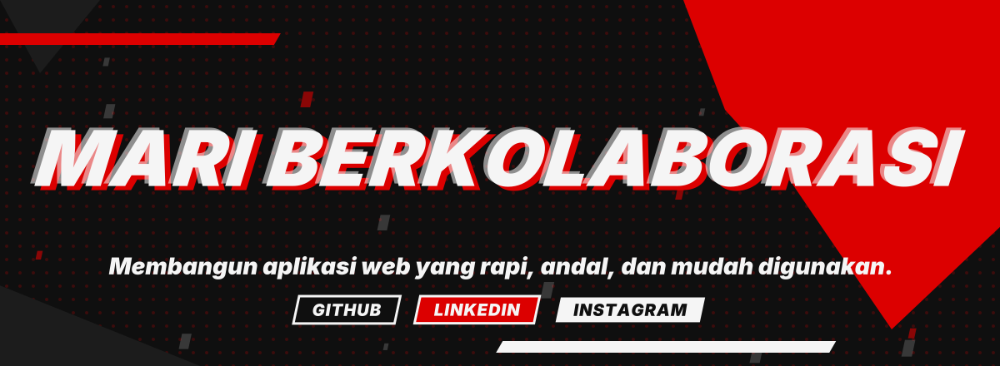

<div align="center">



<br/>

[](https://nextjs.org)
[](https://tailwindcss.com)
[](https://expressjs.com)
[](https://vercel.com)
[](https://render.com)

**4 proyek · 2 selesai · 2 lagu original · tanpa database**

</div>


## ◣ What is this?

Portofolio **Vassell Enha Atthayya** (*Marcell*) — Full Stack Developer, Telkom University — Sistem Informasi.
Konten dibuat formal dan profesional, sementara antarmukanya meminjam gaya visual **Persona 5**: kotak miring, merah-hitam-putih, menu perintah berbentuk kipas, intro kaca pecah, dan **Jukebox** dengan musik original (Suno).

> _Membangun aplikasi web yang rapi, andal, dan mudah digunakan._

Mahasiswa Sistem Informasi Telkom University yang berfokus pada pengembangan web full stack, dari perancangan basis data hingga antarmuka pengguna. Saat ini magang di Biro Teknologi Informasi PT Adhi Karya (Persero) Tbk, mengembangkan sistem tiket helpdesk dan asisten virtual untuk kebutuhan layanan TI internal.




<details><summary>Versi teks</summary>

| Stat | Level | Skill |
|---|---|---|
| **Analisis** | `▰▰▰▰▰▰▰▰▱` 8 | Sistem Informasi, analisis & perancangan sistem, SQL, JavaScript |
| **Eksekusi** | `▰▰▰▰▰▰▰▱▱` 7 | Deploy ke production, debugging, ikut kompetisi bisnis |
| **Teknis** | `▰▰▰▰▰▰▰▰▱` 8 | Next.js, React, Node.js, Express, Tailwind CSS |
| **Kolaborasi** | `▰▰▰▰▰▰▰▱▱` 7 | Code review, dokumentasi, kerja lintas tim |
| **Komunikasi** | `▰▰▰▰▰▰▱▱▱` 6 | UI/UX, presentasi, storytelling produk |

</details>



<details><summary>Versi teks</summary>

- **Frontend:** `Next.js` · `React` · `Tailwind CSS` · `JavaScript` · `HTML/CSS`
- **Backend:** `Node.js` · `Express` · `REST API` · `SQL` · `JSON data layer`
- **Tools:** `Git & GitHub` · `Vercel` · `Render` · `VS Code`
- **Domain:** `Sistem Informasi` · `Analisis Sistem` · `UI/UX` · `Business Plan`

</details>



<details><summary>Versi teks</summary>

| Proyek | Status | Deskripsi | Teknologi |
|---|---|---|---|
| **Enterprise Helpdesk 2.0 & E.V.A** | `SELESAI` | Sistem tiket helpdesk internal PT Adhi Karya + asisten virtual E.V.A (magang KPPM, Biro TI) | Next.js, Node.js, REST API |
| **AMANIN** | `BERJALAN` | Asisten AI anti-scam untuk melindungi masyarakat dari penipuan digital — RISE 2026 Business Plan Competition | AI Assistant, Business Plan |
| **Pharvia** | `BERJALAN` | Platform digital pharmaceutical take-back: mengembalikan obat sisa/kedaluwarsa dengan aman | Web Platform |
| **Portfolio** | `SELESAI` | Situs portofolio pribadi yang sedang kamu lihat — ringan, bertema Persona 5, tanpa library animasi | Next.js, Express, Tailwind CSS, Vercel |

</details>



<details><summary>Versi teks</summary>

| Peran | Nama |
|---|---|
| **Dosen Pembimbing** | [EDIT] Nama Dosen Pembimbing |
| **Supervisor — Biro TI Adhi Karya** | [EDIT] Nama Supervisor Lapangan |
| **Mentor** | [EDIT] Nama Mentor |
| **Rekan Tim AMANIN / Pharvia** | [EDIT] Nama Rekan Tim |

</details>



| # | Track | Durasi |
|---|---|---|
| 01 | The Weight of a Man | 4:00 |
| 02 | As the Black Feathers Fall | 4:00 |


## ◣ Pengalaman

- **Intern — KPPM (Full Stack)** — PT Adhi Karya (Persero) Tbk — Biro Teknologi Informasi
- **Peserta — RISE 2026 Business Plan Competition** — Tim AMANIN _(2026)_
- **Mahasiswa S1 Sistem Informasi** — Telkom University

## ◣ Fitur interaktif

- **Pembuka sinematik** — gerbang "Masuk", kaca retak & pecah, serangan beruntun, lalu potret muncul tepat saat lagu masuk bagian puncak (canvas + SFX orisinal, sekali per sesi, bisa dilewati / tanpa suara)
- **Stat Allocator** — alokasikan poin, naik level
- **Menu cepat** — tekan `M` untuk menu perintah ala Persona
- **Potret Kaca** — ilustrasi di Home terbuat dari keping kaca berpegas: dorong dengan kursor, klik untuk gelombang kejut
- **Playground** — mini-game & tools yang bisa dimainkan
- **Jukebox** — shuffle, repeat, Media Session (kontrol dari lockscreen), preferensi tersimpan
- **SFX** — efek suara Web Audio (klik, flip, buka panel), bisa dimatikan
- **Dark / Light mode** — kontras hover diaudit di kedua tema

## ◣ Struktur

```
.
├── api/        Express 5 — membaca api/data/*.json (tanpa database)
├── web/        Next.js App Router + Tailwind 3 (fallback data di web/data)
├── scripts/    gen-readme.mjs · template · font untuk SVG
├── assets/     SVG animasi README (dibuat otomatis)
└── dev.mjs     jalankan api + web sekaligus
```

## ◣ Jalankan lokal

```bash
npm install            # root: dev tooling
npm --prefix api install
npm --prefix web install
node dev.mjs           # api :4000 · web :3000
```

## ◣ Update README otomatis

README ini **dibuat oleh generator** dari data proyek — jangan edit `README.md` langsung.

```bash
npm run readme   # regenerasi README.md + assets/*.svg
npm run hooks    # pasang pre-commit hook: README ikut ter-update tiap commit
```

Sumber: `api/data/*.json`, `web/public/music/playlist.json`, dan `scripts/README.template.md` untuk teks statis.



<div align="center">

[GitHub](https://github.com/vassellenha) · [LinkedIn](https://www.linkedin.com/in/vassell-enha-atthayya-182661323/) · [Instagram](https://instagram.com/vassellenha)

<sub>Dibuat otomatis oleh <code>scripts/gen-readme.mjs</code></sub>

</div>
